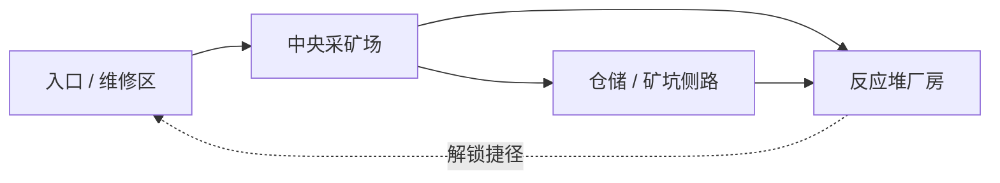

# 第三版：废土矿区整体重制

用户已明确批准按本方案开始第三版开发，并补充统一天空盒、右摇杆四向移动、隐藏系统手柄与手臂。沿用 Spatial SDK 正式版 6.2.6、现有包名及 Full Space Stage。实施和验证结果另行记录，不把方案描述当作完成证据。

## 已确认的问题

- `WeaponView.kt` 仍加载 V1 的 `blaster-a.glb`；`AnimatedActor.kt` 的敌人持枪也使用它。
- `OutpostEnvironment.kt` 仍创建方块峡谷、纯色大地、球形太阳，以及方块/球形发光道具。
- `WastelandScene.kt` 的枪口与敌人弹丸使用球体，曳光、退壳、命中火花及爆炸主要由盒体构成。
- 三类敌人共用同一个 RobotExpressive 模型；精英靠缩放及外加方块肩甲区分。远程持枪也没有跟随手部关节。
- 原生贴图道具、Kenney 玩具枪、纯色几何体和 RobotExpressive 的比例与表面表现不一致。
- 通行范围 X=-6.7…6.7、Z=-20.7…1.3，约 13.4×22 米、295 平方米。80 米的背景地面没有扩大实际探索范围。
- 规则自检和骨骼播放通过只能证明功能与加载。V3 验收必须加入整体视觉一致性、近距离枪械质量和动态战斗反馈。

## 美术方向

统一为手绘风格的废土工业科幻：有重量的轮廓、厚重装甲、磨损金属、积尘与裂纹、克制的描边和分层明暗。环境主色为沙岩、锈橙、深铁灰；青色主要表示电力设备和电击，不让所有物体发光。

同一套比例、材质粗糙度、磨损强度、贴图细节密度和光照贯穿人物、枪械、设施、地面及远景。枪械握把与扳机区符合近距离 VR 观察；机器人从剪影即可识别角色类型。

天空盒也属于同一套美术：废土尘云、暖色低角度日光、远山与矿区地平线统一，避免纯色天空和球形太阳。天空、背景、场景材质及照明共同匹配色温和明暗层次。

旧可见资产退出 V3 的加载清单，并清理不再使用的运行时文件。历史源包和验证记录保留在 assets-src / artifacts。简单碰撞体继续隐藏使用。准心保留，取消用可见方块充当枪械零件、装甲、岩石与特效的做法。

## 地图建议

目标探索范围约 80×100 米，分区组织；可走地面、路线、碰撞与任务一起扩展。该尺寸是设计目标，需要在关卡搭建与真机性能验证后落实。外部矿山、远处设施和地平线形成更大的视觉纵深。

| 区域 | 视觉与空间 | 战斗或探索作用 |
| --- | --- | --- |
| 入口与车辆维修区 | 报废矿车、维修棚、管线、道路 | 熟悉武器，进入主场；后期解锁返回捷径 |
| 中央采矿场 | 起重机、矿石堆、破损平台、输送带 | 多方向战斗，具有可辨认的大型地标 |
| 仓储区与矿坑侧路 | 货运仓库、集装箱、地下设备入口 | 侧翼进攻、补给、电力支线和探索奖励 |
| 反应堆厂房 | 高耸工业建筑、核心设备、上下层通路 | 精英战、阶段性破甲、电击升级和最终目标 |

区域连接示意，不代表最终几何比例：

通过道路、坡道、平台、门和捷径连接区域；同时提供开阔交战、近距离掩体战及室内交战。目标通关时长约 10–15 分钟，不让地图扩大成空地。支线为主线提供有意义的补给或电力优势。

右摇杆控制前后左右连续移动，默认按头部水平朝向计算方向，并处理死区、斜向速度、墙体/掩体/门禁及坡道。左摇杆左右用于分段转向，向前保持再松开用于瞬移；水平转向与瞬移选择互斥，避免误触。进入新区域后记录检查点，死亡不强制重跑全图。

全空间游戏只显示武器等游戏模型，隐藏系统渲染的手柄、手部和手臂；跟踪与按钮输入继续使用真实手柄。使用 6.2.6 公共渲染开关并验证实际 Stage 行为，不用背景物体遮挡手柄或手臂。

## 资产生产与接入

用户于 2026-10-15 明确改用 Meshy 第三方服务，通过 Spatial Editor 原生 MCP 的 `generate_3d_model(engine="meshy")` 生成，复用一个编辑器窗口和一条 MCP 连接。停止先前的托管 Workflow、Pico3D 后端与直接 REST 试验。当前安装的 Editor 6.1.8 支持文字/图片/多视图、PBR 和面数控制。三件样板的实际请求记录和网络失败证据见 `artifacts/2026-10-15-v3/`；提交任务成功不代表第三方已生成模型。

先制作一把步枪、一个基础敌人和一套岩石/工业设施作为统一样板，接入一段完整战斗区域，再按一致规格扩展。每个独立资产写清形体、部件、材质、朝向及运行时用途，重复道具复用同一资产。

| 资产组 | 生产要求 |
| --- | --- |
| 步枪、霰弹枪 | 独立且清晰的枪身、弹匣、枪机/泵动、扳机、枪口节点；握持尺度正确，近距离侧面及背面也有细节 |
| 冲锋机械敌人 | 窄而前倾的剪影，长腿或机械足，近战执行器，短距离突进与明显起手 |
| 远程机械敌人 | 枪械/炮臂与瞄准传感器，掩体探身射击，后撤与侧翼移动 |
| 装甲精英 | 重型比例、可拆装护甲、发光弱点和独有武器；不靠放大基础模型区分 |
| 环境模块 | 沙岩、矿石堆、路面、工业墙体、仓库、起重机、输送带、矿车、发电设备、反应堆、宝箱及碎片 |
| 弹药与损毁碎片 | 可辨认的弹壳、弹头/能量弹体、金属碎片，与武器或敌人材料一致 |

生成的模型需要整理拓扑、UV、材质数量、模型尺寸、轴向、支点和零件命名，并制作适合近中远距离的版本。生成成功不自动等于可运行的角色或枪械。

当前 Editor 生成入口未发现公开的自动绑骨、动作生成或动作重定向接口。角色采用可分离机械部件加公共 Entity/关节动画，或者接入经过实际验证的骨架；枪械也由明确零件节点驱动换弹和机械动作。批量生产前先验证这条路径，避免拿到整块静态模型后再假装有动画。

## 射击与特效重做

- 普通枪弹以射线命中为主，配合短曳光和真实形状的退壳。需要慢速躲避的敌人攻击使用有外壳或能量结构的弹丸。
- 枪口火焰采用短促的多层闪光、烟气和少量火星，朝向跟随枪口；火焰与照明强度随武器区别。
- 命中按材料区分：金属有火星与碎屑、岩石有尘土、装甲有碎片及损伤、弱点有专属电击或破甲反馈。
- 爆炸有起爆闪光、火焰、烟尘、碎片及地面痕迹，并限制透明层叠和持续时间。
- 电击沿目标或附近导体呈现短弧，并与实际眩晕、攻击打断一致。
- 使用 6.2.6 公共 `ParticleComponent`、运行时背面描边与程序化动作。Meshy 负责模型形体和基础 PBR 贴图，动态粒子、枪口挂点与音效由运行时实现。
- 音频增加枪械层次、装甲命中、弹壳落地、机械脚步、空间距离衰减、室内外混响差异。近处有力度，远处能够判断敌人方向。

## 其他玩法优化

1. 用可通行导航数据替换当前遇到障碍后简单横移的策略，支持绕行、巡逻、掩体选择、追击和返回。
2. 远程敌人有探身射击与换位，冲锋敌人有突进起手，精英有破甲/弱点阶段；行为与动画同步。
3. 命中体跟随实际身体与头部动作，敌人武器跟随机械臂或手部关节。射击预警呈现在动作、武器和弱点上。
4. 增加武器手感差异：连射扩散与恢复、霰弹有效距离、瞄准稳定性；后坐、动作、音效和震动来自同一个射击事件。
5. HUD 收敛：任务短提示、生命、武器弹药为主；交互提示出现在目标旁，减少相机下方的大段说明。
6. 主线与区域检查点、支线供电、补给及战利品构成连贯流程，控制敌人同时出现的数量。

## 性能与交付顺序

更大的场景按区域加载与激活；静态重复物体共享模型和材质，近处角色/枪械保留细节，远景降低细节。限制同时活动的骨骼、粒子、透明烟雾和动态灯，按真机数据调整，而不以面数高低代替画质。

顺序为：统一样板及一段完整战斗 → 环境和角色替换 → 地图分区与路线 → 武器/特效/音频 → AI、检查点和 UI → 真机性能及视觉验收。

验收目标：启动、重开、换区都不再出现旧可见资产；任何区域和主武器的风格一致；角色能正确行动和持枪；近处特效有材料区分；地图实际可探索；移动、任务和命中正确。90 fps 为性能目标，必须以真机测量确认。助手可进行 Editor 内部视觉审查，不要求用户提供截图。
